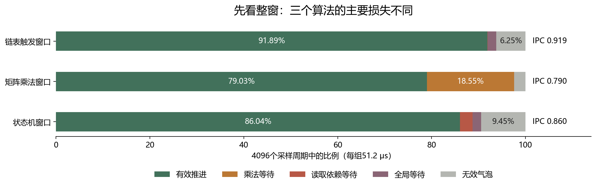
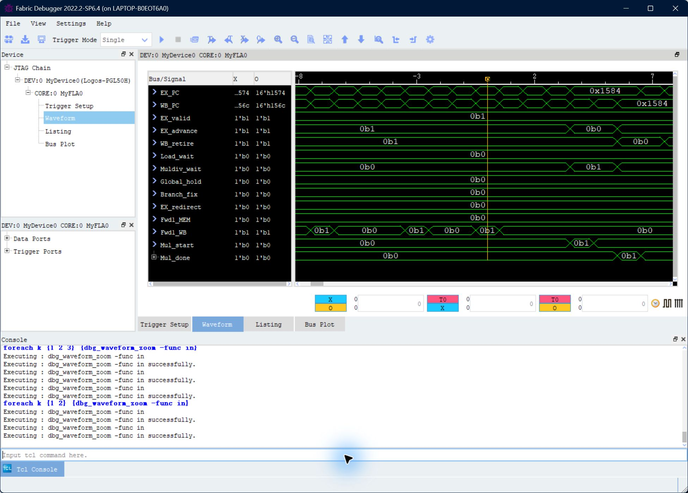
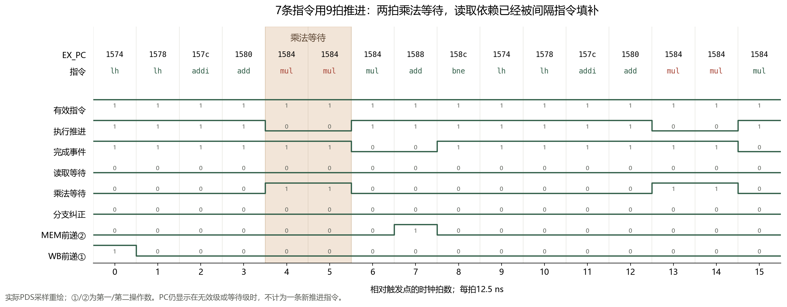
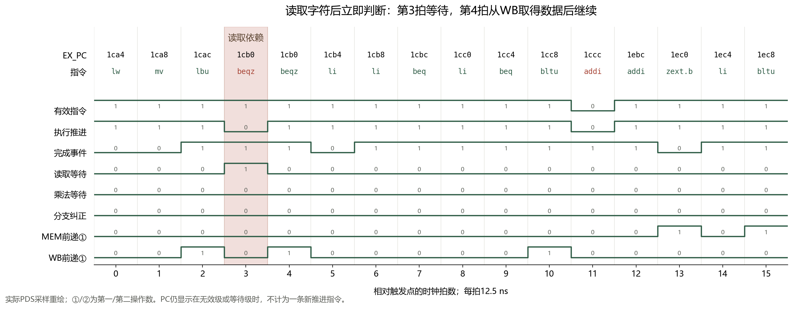
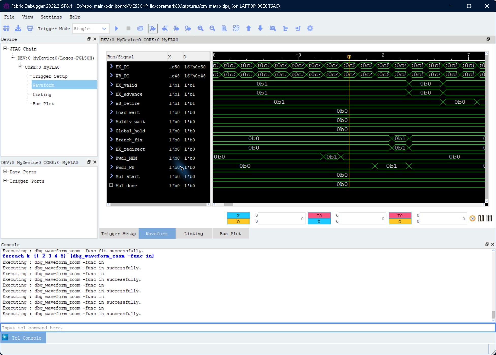
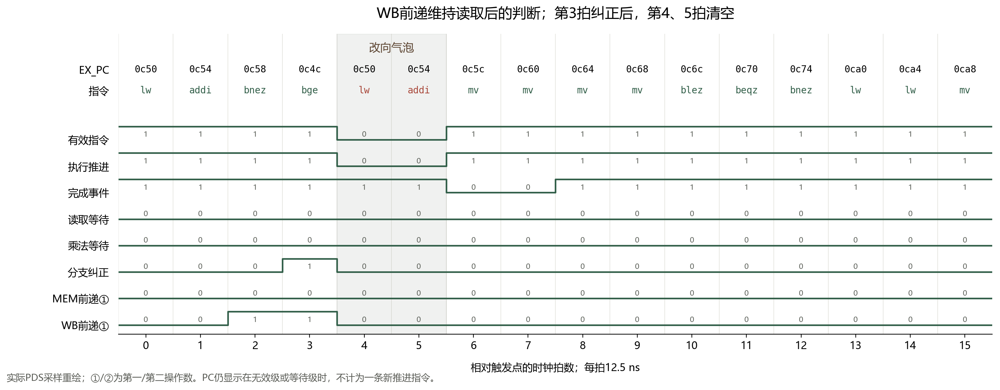
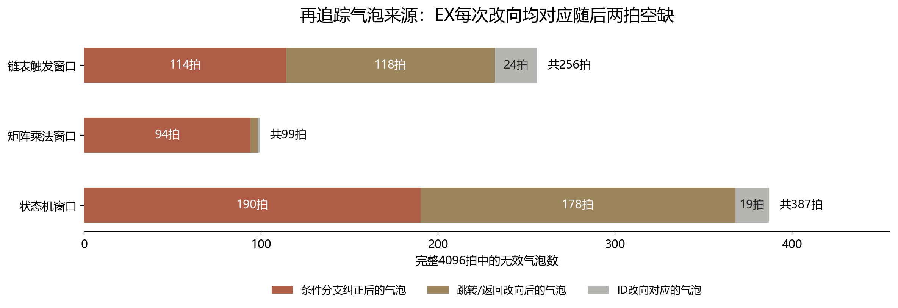

# CoreMark 板上流水线效率分析

采集日期：2026 年 10 月 28 日。分析整理：2026 年 10 月 29 日。

本次分析围绕真实 CoreMark 指令展开。我们从 PDS 原始波形出发，将指令地址对应到程序，再逐拍检查前递、等待、改向和完成事件，最后统计完整采样窗口，判断不同算法的主要周期开销。

分析得到三点结论：

- **矩阵乘法主要受乘法等待限制。** 两次读取与地址计算能够连续推进，但每次乘法仍等待两拍。
- **状态机主要受控制改向影响，同时存在立即使用读取结果的等待。** 387 拍气泡可以结合改向事件进一步分解；其中 368 拍紧跟执行级改向出现。
- **链表局部已体现前递的作用。** 读取指针后的判断能够连续推进；分支纠正则在执行端形成两拍气泡，并在稍后的完成端留下对应空缺。

以下按“采集依据 → 指令定位 → 波形解读 → 周期核算 → 优化推断”的顺序说明。图中“第几拍”均以触发点为第 0 拍。

## 一 实验条件与采集依据

### 1.1 使用同频 CoreMark 工程

此前的定向自检主要证明前递、load 等待、分支和异常等功能。为了观察实际算法的执行效率，我们改为在 **80 MHz** 下运行 CoreMark v1.01，并在算法内部设置采集触发点。

| 项目 | 本次设置或结果 |
|---|---|
| 开发板 | MES50HP |
| CPU 与采样时钟 | 80 MHz，每拍 12.5 ns |
| 程序 | CoreMark v1.01，数据规模 2000 字节，5000 次迭代 |
| 编译 | GCC 14.2.0，`-O2 -march=rv32im_zicsr -mabi=ilp32` |
| 探针 | 60 位，记录执行/完成地址、有效位、推进、等待、改向和前递 |
| 每组采集 | 连续 4096 拍，即 51.2 μs；包括触发前 128 拍 |
| 实现结果 | 全部时序约束满足；最差 setup +0.211 ns，hold +0.041 ns |
| 含调试逻辑资源 | LUT 5267、FF 4107、DRM 78、APM 4、PLL 1 |

我们将此前较宽的操作数观察，改为观察指令位置与控制行为；全部探针统一寄存一拍后进入 ILA。这样既能在 80 MHz 下采集，也保留了 PC 与状态之间的逐拍对应关系。

CoreMark 本轮运行输出：

```text
crclist   = 0xe714
crcmatrix = 0x1fd7
crcstate  = 0x8e3a
crcfinal  = 0xbd59
Correct operation validated.
总周期 = 1,870,726,505
```

按 80 MHz 换算，整轮约 23.384 秒。程序运行校验与 ILA 波形共同构成分析依据；本文关注算法局部的流水线行为。

### 1.2 根据实际编译结果定位算法

我们使用本次 ELF 的反汇编和符号表定位触发点，随后用采样到的执行地址检查窗口内实际经过哪些函数。

| 窗口 | 触发地址及指令 | 实际经过的主要内容 |
|---|---|---|
| 链表触发窗口 | `0x0c50: lw a5,0(a5)` | 链表排序、比较回调及 CRC |
| 矩阵窗口 | `0x1574: lh a4,0(a5)` | 矩阵乘法内层循环 |
| 状态机窗口 | `0x1ca4: lw a3,0(a0)` | 状态转换与外层字符扫描 |

地址归属核对提供了重要背景：矩阵窗口中有 3133/3237 次推进位于 `matrix_mul_matrix`，约 **96.8%**；状态转换与外层扫描合计 3490/3524 次，约 **99.0%**。这两组适合分别讨论乘法循环和状态判断。

链表触发窗口中，`crcu16` 有 2436 次推进，占 **64.7%**；排序函数自身为 254 次。因此我们把它称为“链表触发窗口”，既利用触发附近分析指针和分支，也结合 CRC 的占比解释整窗效率。

## 二 我们怎样从波形分析效率

### 2.1 先分清有指令 停在原地 和完成新指令

| 观察量 | 分析用途 |
|---|---|
| `EX_PC` | 将执行级指令对应到反汇编 |
| `EX_valid` | 判断执行级中是否有有效指令 |
| `EX_advance` | 判断这一拍是否推进了一条有效指令 |
| `WB_retire` | 统计到达完成位置的指令，包含分支、存储等不写通用寄存器的指令 |
| `Load_wait / Muldiv_wait` | 区分读取依赖与乘除法等待 |
| `Global_hold` | 判断是否出现整个流水线的等待 |
| `Branch_fix / EX_redirect` | 区分条件分支纠正与更广的执行级改向 |
| `Fwd*_MEM / Fwd*_WB` | 检查所用操作数怎样从后级提供 |

例如，矩阵中的 `EX_PC=0x1584` 连续显示三拍。我们同时看到前两拍 `EX_advance=0`、第三拍为 1，才判断这是**一条乘法占据执行级三拍，其中额外等待两拍**。

完成事件使用随流水级推进的观察用有效位，并通过 EX 与完成端的 PC 序列交叉核对。暂停时保持状态，避免把同一条指令重复计算。

### 2.2 每拍只归到一种主要状态

对完整 4096 拍，我们依次检查：

```text
全局等待 → 读取依赖等待 → 乘除法等待 → 无效气泡 → 有效推进
```

这样可以把时间账算平。条件分支纠正、乘法启动和前递则作为事件另外统计，再与相关等待和气泡对齐。

```text
窗口 IPC = 完成指令数 ÷ 4096
窗口 CPI = 4096 ÷ 完成指令数
```

三组完整窗口的结果如下：

| 指标 | 链表触发 | 矩阵乘法 | 状态机 |
|---|---:|---:|---:|
| 完成指令数 | 3764 | 3237 | 3523 |
| IPC | 0.919 | 0.790 | 0.860 |
| CPI | 1.088 | 1.265 | 1.163 |
| 有效推进 | 3764 | 3237 | 3524 |
| 乘除法等待 | 0 | 760 | 0 |
| 读取依赖等待 | 2 | 0 | 110 |
| 全局等待 | 74 | 0 | 75 |
| 无效气泡 | 256 | 99 | 387 |

状态机的推进与完成相差一条，来自采样边界处尚在流水线中的指令；上述两种计数分别保留。



**图1为实际采样数据的重绘。** 我们先用它判断主要损失：矩阵的等待集中在乘法；状态机的气泡占比更高；链表触发窗口有较多可连续执行的 CRC 指令。接下来再回到原始截图和具体指令解释这些差异。

## 三 矩阵乘法 怎样确定主要开销是乘法等待

### 3.1 从 PDS 原始图确认停顿位置



**图2为归档的 PDS Fabric Debugger 原始截图，未重画。** 黄色第 0 拍对应 `EX_PC=0x1574`。向右观察，PC 在 `0x1584` 停留，`Muldiv_wait` 拉高，同时 `EX_advance` 拉低；`Global_hold` 和 `Load_wait` 保持为 0。这先把停顿定位到乘法单元，而非存储器或读取依赖。

### 3.2 将地址对应到内层循环

```asm
1574: lh   a4,0(a5)       # 读取一个矩阵元素
1578: lh   a1,0(a3)       # 读取另一个矩阵元素
157c: addi a5,a5,2        # 更新读取地址
1580: add  a3,a3,a0       # 更新另一读取地址
1584: mul  a4,a4,a1       # 两个元素相乘
1588: add  a2,a2,a4       # 累加乘积
158c: bne  a6,a5,1574     # 继续内层循环
```

指令本身已经给出一个解释：读取之后有两条独立地址计算，可以利用这段时间等待数据到达；乘积之后立即累加，则需要乘法先完成。

### 3.3 逐拍核对这个解释



| 相对拍数 | 指令/信号 | 我们看到的过程 |
|---|---|---|
| 0、1 | 两条 `lh`；推进为 1 | 连续发出读取 |
| 2、3 | 两条地址计算；推进为 1 | 读取与使用之间有独立工作可做 |
| 4 | `mul`；启动为 1，乘法等待为 1 | 乘法开始，本拍未向后推进 |
| 5 | 仍为 `mul`；乘法等待为 1 | 继续等待 |
| 6 | 完成为 1，推进恢复为 1 | 乘法结果就绪，指令向后推进 |
| 7 | 累加指令推进；第二操作数 MEM 前递有效 | 乘积直接提供给累加，不再额外停顿 |
| 8 | 循环分支推进 | 本轮正常返回，没有纠正气泡 |
| 9 | 再次到达 `0x1574` | 下一轮开始 |

第 0 拍到第 9 拍再次进入循环，相隔 **9 拍**，推进 **7 条指令**：

```text
7条有效指令 + 2拍乘法等待 = 每轮9拍
```

图3中乘法等待发生在第 4、5 拍，而完成端的空缺出现在第 6、7 拍。它说明停顿不是某根信号孤立变化，而是沿流水线传到了指令完成端。

### 3.4 再用整窗次数验证

完整窗口记录到 **380 次乘法启动、380 次完成、760 拍乘法等待**：

```text
380次 × 每次2拍 = 760拍
760 ÷ 4096 = 18.55%
```

窗口中有 760 次读取推进，但读取依赖等待为 **0**。据此我们判断：**当前指令安排和数据提供方式已较好地覆盖这段循环的读取延迟，主要剩余开销是乘法执行期间的等待。**

7/9≈0.778 的循环推进效率，也接近整窗 IPC 0.790。少量循环外代码与分支行为解释了二者的差别。

**优化推断：** 若保持频率和其他行为，每次乘法少等待一拍，这个窗口约能减少 380 拍，即 **9.28% 的周期**；同等工作量下局部吞吐约增加 **10.2%**。因此，若继续研究该窗口，乘法结果更早就绪比继续调整两次读取更值得优先考虑。

## 四 状态机 怎样找到立即读取依赖与控制开销

### 4.1 先找到读取后立即判断的位置


图4触发点为 `0x1ca4`。右侧可以看到 `EX_PC=0x1cb0` 停留，`Load_wait` 拉高、推进暂时拉低。乘法等待为 0，因此我们转向读取结果与分支操作数之间的关系。

对应指令为：

```asm
1cac: lbu  a5,0(a3)      # 读取当前字符
1cb0: beqz a5,1f2c       # 立即根据该字符判断
```

### 4.2 观察数据什么时候可用



| 相对拍数 | 观察 | 分析 |
|---|---|---|
| 2 | `lbu` 推进 | 发出字符读取 |
| 3 | `beqz` 停留；`Load_wait=1`，推进为 0 | 判断所需字符尚未到可供执行级使用的位置 |
| 4 | 同一条 `beqz` 推进，第一操作数 WB 前递有效 | 数据到达后，直接参与判断 |
| 5 | 执行端已继续，但完成事件为 0 | 之前的一拍停顿在完成端形成空缺 |

这里与矩阵的差异很清楚：矩阵在读取后夹着独立计算，而状态机在读取后立即判断，所以依赖暴露成一拍等待。

它也与当前时序优化结构一致：执行级的 MEM 前递只提供非 load 结果，读取数据经过 WB 寄存后再供执行级使用。**波形表明，这种结构在有独立指令间隔时能覆盖等待；立即使用时则付出一拍代价。**

### 4.3 统计哪些位置最常等待

整窗共有 110 拍读取依赖等待，其中：

| 执行地址 | 等待拍数 | 占全部读取依赖等待 |
|---|---:|---:|
| `0x1cb0` | 44 | 40.0% |
| `0x1d14` | 20 | 18.2% |
| `0x1ee0` | 13 | 11.8% |
| `0x1d9c` | 13 | 11.8% |
| 其余位置 | 20 | 18.2% |

因此，若要做针对性的依赖分析，先看 `0x1cb0` 及类似的字符读取后判断，比从所有 load 指令中平均用力更有效。

不过，110 拍只占整窗 **2.69%**；单独处理 `0x1cb0` 对应约 **1.07%**。再看同一窗口还有 **387 拍气泡，占 9.45%**，说明控制流是更大的分析对象。

### 4.4 把387拍气泡继续追溯到改向事件

我们这次补做了逐次对齐：每遇到一拍有效的执行级改向，就检查随后两拍是否为无效气泡。三组窗口中的所有执行级改向都符合这个两拍模式。

状态机窗口有：

- 95 次条件分支纠正，对应 **190 拍**气泡；
- 89 次其他跳转/返回类执行级改向，对应 **178 拍**气泡；
- 其余 **19 拍**可以在 ID 级提前改向的取指空缺中找到对应。

```text
95 × 2 + 89 × 2 + 19 = 387拍
```

其中 17 拍 ID 相关气泡出现在改向后 1～2 拍；另外两拍被中间的读取等待向后推移。例如相对第 20 拍 ID 改向，第 21 拍全局等待、第 22 拍读取依赖等待，第 23 拍分支推进，气泡到第 24 拍才出现在执行级。

**由此可以把状态机的主要气泡归结为控制改向后的取指恢复开销。** 条件分支纠正只解释其中一部分，跳转和返回带来的改向同样值得关注。

本窗口有 904 条条件分支，占 3524 次推进的 **25.7%**，其中 95 条触发执行级纠正，纠正比例约 **10.5%**。这说明它的控制判断密集，进一步降低改向频率或缩短恢复过程，预计比单独消除一处字符依赖更有空间。

## 五 链表 怎样从前递看到连续推进 从纠正看到气泡

### 5.1 先看原始PDS截图



黄色第 0 拍对应 `0x0c50` 的指针读取。之后 WB 前递信号出现，分支纠正拉高，再出现两拍执行级无效。下面将它与指令展开对齐。

### 5.2 前递解决了哪两处数据关系

```asm
0c50: lw   a5,0(a5)      # 读取下一个链表指针
0c54: addi s0,s0,1       # 计数加一
0c58: bnez a5,0c4c       # 根据新指针判断
0c4c: bge  s0,s5,0c5c    # 根据新计数比较
```



| 相对拍数 | 数据关系或行为 | 波形依据 |
|---|---|---|
| 0 | 读取 `a5` 指针 | `lw` 推进 |
| 1 | 更新 `s0` | `addi` 推进 |
| 2 | 分支使用刚读出的 `a5` | 第一操作数 WB 前递为 1，没有读取等待 |
| 3 | 比较使用刚更新的 `s0` | 第一操作数 WB 前递为 1，分支纠正为 1 |
| 4、5 | 清除旧路径指令 | 执行级有效和推进均为 0 |
| 6 | 目标 `0x0c5c` 恢复推进 | 执行端恢复，完成端暂时仍为空 |
| 8 | 目标指令到达完成端 | 完成事件恢复 |

这段可以得到两层结论：

1. `lw → 分支` 之间隔着一条独立计数指令，读取结果到 WB 时恰好可以提供给判断；计数结果也通过 WB 前递给随后的比较。数据相关没有使第 0～3 拍停住。
2. 即使数据已经及时到达，预测路径仍可能需要纠正。第 3 拍纠正后，第 4、5 拍清空，第 6 拍恢复，属于控制流开销。

整窗有 **1696 条推进指令实际使用了前递，占 45.1%**。读取依赖等待只有 2 拍，说明这组混合窗口中，前递与指令间隔对连续执行起到了明显作用。

### 5.3 为什么这组IPC最高

链表触发窗口 IPC 为 **0.919**，高于矩阵和状态机。结合地址归属可以推断，较大比重的 CRC 循环包含连续的移位、异或、计数与判断，许多依赖能通过前递解决，所以整窗保持较高推进密度。

这不是“链表一定比矩阵快”的结论，而是解释了**这次所截到的程序片段为什么更接近每拍推进一条**。触发附近仍清楚展示了链表指针处理，以及一次分支纠正的两拍开销。

## 六 把三个窗口的控制开销放在一起比较



图8在原来的周期统计之上，增加了事件与后续气泡的逐拍对齐。

| 项目 | 链表触发 | 矩阵乘法 | 状态机 |
|---|---:|---:|---:|
| 条件分支纠正次数 | 57 | 47 | 95 |
| 对应两拍气泡 | 114 | 94 | 190 |
| 其他跳转/返回类执行级改向次数 | 59 | 2 | 89 |
| 对应两拍气泡 | 118 | 4 | 178 |
| ID 级改向对应气泡 | 24 | 1 | 19 |
| 气泡合计 | 256 | 99 | 387 |

三组气泡账都能核对：

```text
链表：114 + 118 + 24 = 256
矩阵： 94 +   4 +  1 =  99
状态：190 + 178 + 19 = 387
```

这个结果说明，**气泡较多的状态机窗口并非单纯因为条件分支更多，还因为跳转/返回类改向更多。** 如果只看 `Branch_fix` 一根信号，会漏掉相当一部分控制开销。

此外，链表和状态机分别有 74、75 拍全局等待。逐拍核对时，这些拍均对应 MEM 级读取请求有效而 `dmem_ready=0`。因此可以把它们归入数据存储访问的等待，并与 EX 级读取依赖等待区分。

## 七 从分析结果推断下一步优化重点

这次的价值不只在于证明程序能运行，还在于把“哪里在浪费周期”落到了指令和控制事件上。

| 观察事实 | 我们的判断 | 优先考虑的方向 |
|---|---|---|
| 矩阵每次乘法等两拍，累计 760 拍；读取等待为 0 | 乘法等待是此窗口最集中的损失 | 研究乘法结果更早就绪、缩短等待或运算与流水的安排 |
| 状态机 387 拍气泡，其中 EX 改向后占 368 拍 | 控制流恢复是主要开销，跳转/返回与条件分支都要看 | 分别统计高频改向地址，检查预测覆盖和恢复过程 |
| 状态机 110 拍读取依赖，`0x1cb0` 占 44 拍 | 立即使用字符结果的依赖有规律，但收益规模较小 | 保留热点位置；涉及前递时同时考虑原有时序路径 |
| 链表混合窗口前递使用率 45.1%，IPC 0.919 | 大量数据依赖已经通过现有结构有效处理 | 保留有效前递，优先解释剩余改向而非全面重做数据通路 |

还可以用同频、相同工作量的局部预算比较优先级：

| 假设性改进 | 对应窗口可减少的周期 | 占原4096拍 |
|---|---:|---:|
| 矩阵每次乘法少等 1 拍 | 380 | 9.28% |
| 状态机每次 EX 改向少损失 1 拍 | 184 | 4.49% |
| 状态机消除全部读取依赖等待 | 110 | 2.69% |
| 仅消除状态机 `0x1cb0` 的读取依赖 | 44 | 1.07% |

据此，我们会优先研究矩阵乘法等待，其次研究状态机的控制恢复，再看单一字符读取热点。上述预算给出的是改动值得研究的程度，实际取舍还要结合新结构能维持的频率和资源。

从已有结构的效果看，当前处理器已能在多种算法中保持较高连续推进率：局部 IPC 为 **0.790～0.919**。它的效率差异有明确程序原因：矩阵重复使用多周期乘法，状态机频繁进行字符判断和改向，CRC 混合窗口则更容易利用前递连续执行。这个对应关系，比只展示 PASS 或最后一次跑分更能体现流水线设计的工作过程。

## 八 正式报告怎样选图和组织论述

建议正文采用以下次序：

1. **实验设置与方法：** 80 MHz、真实 CoreMark、三处触发、4096 拍，以及执行/完成事件的计数口径。
2. **总览：** 图1和总表，先给出算法之间的效率差异。
3. **矩阵案例：** 图2原始截图 + 图3重绘，说明 7 条指令/9 拍、每乘法两拍等待。
4. **状态机案例：** 图4原始截图 + 图5重绘，说明立即读取依赖，并用图8继续拆分控制开销。
5. **链表案例：** 图6原始截图 + 图7重绘，说明前递如何保持连续推进，以及纠正怎样传到完成端。
6. **优化判断：** 结合局部预算说明下一步优先级。

如果篇幅紧，正文保留图1、矩阵的一组原图/重绘、图5和图8；其余原始截图放附录。每张图的说明要写“哪一拍、哪条指令、哪些信号变化、因此怎样判断”，不要只写“波形正确”。

可以采用如下结论段：

> 我们在与应用相同的 80 MHz 下，利用 ILA 观察真实 CoreMark 关键算法，并把反汇编指令、流水线状态和整窗周期统计对应起来。矩阵内层循环的 7 条指令用 9 拍推进，380 次乘法累计产生 760 拍等待，而读取依赖等待为零；状态机在字符读取后立即判断时出现一拍等待，同时执行级改向形成规律的两拍气泡，是该窗口更主要的损失；链表触发片段则通过 WB 前递连续完成指针判断和计数比较。由此可见，当前设计已较好地处理了许多数据相关，进一步提升效率应针对多周期乘法和高频控制改向分别展开。

本文统计的对象是三段各 51.2 μs 的算法窗口；用“矩阵窗口”“状态机窗口”等名称标明范围即可，整轮成绩另用完整运行记录说明。

## 附录 图表与数据位置

本目录可整体复制给报告作者，图片采用相对路径引用。

| 内容 | 位置 |
|---|---|
| 3 张 PDS 原始截图 | `pds_original/` |
| 5 张分析重绘图与 SVG | `figures/` |
| 3 组完整4096拍逐拍CSV | `data/cm_*_data.csv` |
| 原整窗统计 | `data/MEASUREMENTS.json` |
| 本次新增气泡追踪与热点统计 | `data/本次补充统计.json` |
| 原始采集校验信息 | `data/VERIFIED_RESULTS.json` |
| CoreMark串口结果 | `data/coremark_uart.txt` |
| 重绘及核对脚本 | `生成分析图.py` |

原始 `.dprj/.wdf`、ELF、反汇编、符号表和实现报告仍保留在：

```text
D:/repo_main/pds_board/MES50HP_ila/coremark80/
```

本次重新解码了三组归档 WDF，逐位核对 CSV 中的地址和状态，并重新核对周期分类、EX/完成地址序列以及改向后的气泡。没有重新上板或修改原采集。

PDS 截图由同一调试器依次切换采集得到，个别标题栏保留上一次项目名；本报告按截图中的触发 PC、实际波形与同组 CSV 对应。原图保持原样，分析图则明确标为采样数据重绘。
