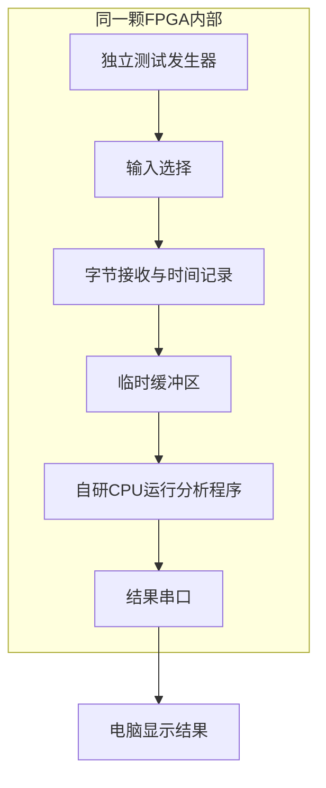
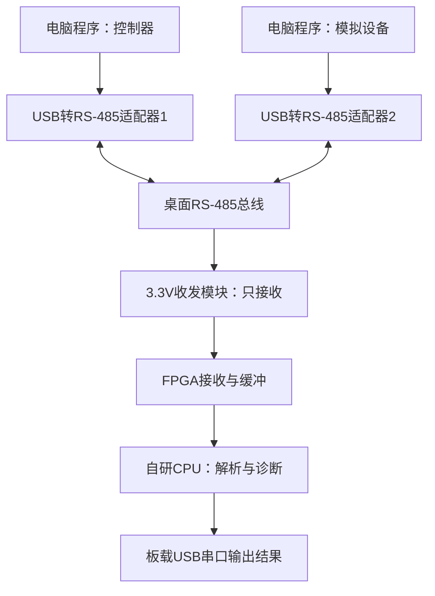

# RISC-V工业通信分析仪实施指南

适用项目：紫光同创赛题一，自研RV32I处理器，盘古50开发板（MES50HP）。

本文从“CPU已经能运行程序”开始，说明如何做出工业通信分析应用，买什么、按什么顺序推进，以及哪些功能应先完成。

**当前推荐目标：做一个能旁听Modbus RTU通信、检查数据错误、统计请求与回复时间，并把结果显示在电脑上的小工具。**

本文的“必做”是为了完成这套方案而制定的工程清单，不代表主办方逐条规定了这些应用功能。赛题和答疑中明确的要求，会另外标明。

---

## 1. 最终作品到底是个什么东西

想象一台控制器正在询问温度传感器：

> 控制器：“1号设备，把第0、1个数据位置里的数值发来。”
>
> 传感器：“收到，这两个位置里的数值分别是256和600。”

这些话实际上是一串数字，通过电线发送。分析仪在旁边听双方通信，然后显示：

> 设备01：收到读取请求。
>
> 设备01：正常回复，校验正确，响应耗时8.4毫秒。
>
> 设备02：超过设定的100毫秒仍未观察到有效回复。

分析仪不需要控制电机或调节温度。它的作用是帮助开发人员或维修人员看懂通信过程，定位“传错了、格式不对、回复太慢、一直没回复”等问题。

最终演示至少包含：正常通信、错误校验、没有回复、持续接收四种情况。每种情况都有可重复的测试输入和真实测量结果。

## 2. 只需要先理解这些名称

| 名称 | 通俗解释 | 在项目里的作用 |
| --- | --- | --- |
| FPGA | 内部电路可以重新配置的芯片 | 用硬件描述代码搭出CPU、接收器、缓冲区等电路 |
| CPU | 按指令运行程序的处理器 | 运行C程序，分析通信内容和异常 |
| RISC-V / RV32I | 处理器应当如何理解指令的一套规则；RV32I是其中的32位基本整数指令集 | 决定C程序编译后，CPU能执行哪些机器指令 |
| 串行通信 | 把数字拆开，一位接一位地发送 | 让设备用少量电线交换数据 |
| UART，通用异步收发器 | 把一个字节变成串口波形，或把波形还原成字节的电路 | 完成最底层的字节收发 |
| RS-485 | 规定两根信号线如何用电压差传输数据的电气标准 | 把FPGA的普通数字信号与实际通信线连接起来 |
| Modbus RTU | 工业设备常用的一种消息格式和通信规则 | 告诉CPU哪些数字代表地址、命令、数据和校验值 |
| 数据帧 | 一整条消息，包含地址、命令、数据和校验值 | CPU处理的基本单位 |
| CRC，循环冗余校验 | 根据消息内容算出一个检查值，用来发现传输错误 | 判断收到的数据是否通过校验；通过也不代表绝对不存在错误 |
| 时间戳 | 记录一件事发生在什么时候的数字 | 计算帧间间隔、响应时间和处理延迟 |
| 缓冲区 | 临时保存收到的数据的一小块存储空间 | CPU稍慢时，先把数据存起来 |
| 波特率 | 此项目中可理解为串口每秒发送多少位 | 决定每一位持续多长时间 |

三者不能混为一谈：UART负责“把字节发出去或收回来”，RS-485负责“电线上怎么传”，Modbus负责“收到的字节是什么意思”。

## 3. CPU做什么，其他电路做什么

不让CPU每个时钟周期都去盯着输入引脚。高速、固定的接收工作交给小电路，规则较多的分析工作交给程序。

| 部分 | 具体工作 | 如何实现 |
| --- | --- | --- |
| 外部RS-485收发模块 | 把总线上的电压差变成FPGA可接收的高低电平 | 购买的小模块 |
| 输入同步电路 | 把外部变化的信号接入本地时钟，降低采样不稳定的风险 | 自己写硬件代码，通常先经过两级寄存器 |
| 串口接收器 | 识别起始位、接收数据位、检查停止位和可选奇偶校验 | 自己写硬件代码 |
| 计时与缓冲电路 | 给字节记录时间，暂存数据，报告缓冲区溢出 | 自己写硬件代码 |
| 自研CPU | 读出数据、拼成帧、校验、解读命令、匹配请求和回复、判断超时 | 已完成的CPU核心，加上C程序 |
| 结果串口 | 将分析结果传给电脑 | FPGA中的串口电路，连接板载USB转串口芯片 |
| 电脑程序 | 发送测试数据，接收并显示板卡输出 | 简单脚本或终端程序 |

**数据分析必须在板上的自研CPU中完成。**电脑负责造测试输入和展示结果；测试时也可作为独立参考答案，但不能替CPU完成协议解析后再让板卡复述。

这颗CPU仍然是通用处理器。以后换协议、增加命令或修改诊断规则，主要改C程序即可。增加新接口或改变硬件采集方式时，才需要修改FPGA电路。

## 4. 最小版本应做到什么

先做“单路、只监听、支持一种常见读取命令”的版本。这里的单路，是监听一对RS-485信号线；同一条线上可以有多个设备地址。

先选择Modbus功能码03，即“读取保持寄存器”。这里的寄存器是设备对外提供的数据位置，与CPU内部的寄存器不是一个概念。

先把展示范围限定为：单个控制器、每次只发一个请求、收到回复或超时后才发下一个请求。这样请求和回复容易配对，不必一开始处理复杂的并发通信。

### 4.1 本项目最小交付必做项

- [ ] 接收一条串口输入，并保留字节、时间和接收错误标记。
- [ ] 按通信间隔把字节分成完整消息。
- [ ] CPU计算Modbus CRC，区分校验正确与错误。
- [ ] 解析功能码03的请求和回复，包括设备地址、数据位置、数据长度。
- [ ] 匹配请求与回复，统计响应时间。
- [ ] 已观察到有效请求但在设定时间内没有匹配回复时，报告超时。
- [ ] 支持正常回复、协议异常回复、错误校验和不完整消息的基本分类。
- [ ] 缓冲区装满时明确报告，不能悄悄丢数据后继续报“正常”。
- [ ] 电脑能看到结果，支持清零统计、修改超时阈值和查看状态。
- [ ] 能接真实RS-485电线演示，而不只是在内部模拟。
- [ ] 有应用测试数据、CoreMark结果、资源和时序报告。

收到未实现的命令时，保留原始数据并显示“暂不支持解析”，不要误判成设备故障。遇到广播请求时，不启动回复超时判断，因为广播不要求设备回复；最低版本也可以明确不对广播做进一步解析。

### 4.2 可以后做的功能

| 功能 | 优先级 | 理由 |
| --- | --- | --- |
| 真实温湿度传感器演示 | 推荐选做 | 展示直观，但电脑模拟设备也能完成真实线路测试 |
| 支持功能码04、06、16等更多命令 | 选做 | 前一种命令稳定后再扩展 |
| 多种波特率、奇偶校验设置 | 推荐选做 | 提高实用性；初期固定一种设置即可 |
| CPU专用CRC指令或校验加速模块 | 性能优化选做 | 有实测瓶颈以后再加入 |
| 波形保存与显示 | 选做 | 增加真正的波形分析能力，但会增加存储与软件工作 |
| 自动判断通信速度 | 选做 | 初期人工设置更容易验证 |
| 多路总线同时监测 | 选做 | 能增加处理负载，也显著增加调试量 |
| 漂亮的图形界面 | 选做 | 简单表格或终端已能展示核心功能 |
| 板上屏幕、SD卡长期日志、联网 | 后期选做 | 不是当前完整演示的必要条件 |
| 主动发送命令或修改总线数据 | 不纳入当前版本 | 会把监听工具扩展成控制器，增加发送方向控制等工作 |

CPU的缓存、分支预测、完整中断等高阶任务，应按赛题单独安排。它们不是这个最小通信应用开始开发的前提。

## 5. 板卡现有接口够不够

按MES50HP硬件手册，完整开发板由核心板和扩展底板组成，具备板载CP2102 USB转串口、Type-C通信接口、40针扩展口、按键和指示灯。[1]

本应用主要用到：

| 板卡资源 | 作用 |
| --- | --- |
| 40针扩展口中的一个普通输入引脚 | 接RS-485模块的接收输出 |
| 扩展口的3.3V和地 | 给合适的3.3V收发模块供电 |
| 板载USB转串口 | 与电脑交换配置命令、输出分析结果 |
| FPGA片上存储器 | 保存程序、工作数据和接收缓冲 |
| 板载时钟 | 驱动CPU、串口与计时电路 |
| 下载调试接口 | 把设计写入FPGA，进行调试 |

**接口上可实现这套方案。最终资源是否够、主频能达到多少，要以实际综合和布局布线报告为准，不能把早期估算当成实测。**

初期使用片上存储器，不必接板上的DDR3。先以程序实际编译大小、运行所需空间和缓冲大小决定容量，再看有没有必要扩大。

注意：板载USB转串口只负责让电脑看到一个串口，不会自动把FPGA变成工业通信分析仪。CPU、接收器、计时、缓冲及协议软件仍需自行实现。

## 6. 采购清单：按阶段买

### 6.1 CPU上板阶段：确认基础套装

| 东西 | 数量 | 是否必需 | 购买或确认要点 |
| --- | --- | --- | --- |
| MES50HP完整开发板 | 1套 | 必需 | 确认包含核心板和扩展底板，不是单卖核心板 |
| 配套电源 | 1个 | 必需 | 手册要求配套12V电源；按实物套装和接口确认 [1] |
| 与板卡和紫光工具兼容的下载器 | 1个 | 若未附送则需买 | 用于下载FPGA设计；确认型号、接线及当前电脑系统支持 |
| Type-C数据线 | 1根 | 必需 | 必须能传数据，不能是只能充电的线 |
| 电脑 | 1台 | 必需，已有即可 | 运行开发工具、测试脚本和结果显示程序 |

卖家是否附送电源、下载器和线材，取决于实际套餐。先确认，避免重复购买。Type-C串口通信线不等于FPGA下载器。

### 6.2 准备做外部线路测试时购买

| 东西 | 推荐数量 | 作用 | 筛选条件 |
| --- | --- | --- | --- |
| 3.3V RS-485收发模块 | 1个，预算允许可备1个 | 给FPGA提供总线接收信号 | MAX3485或同类器件；确认模块供电、输出均适配3.3V，能关闭发送并保持接收 |
| USB转RS-485适配器 | 推荐2个 | 电脑分别模拟控制器和被询问设备 | 支持所选波特率和串口格式，自动收发切换，当前系统驱动可用，最好有信号地端子 |
| 杜邦线 | 少量 | 连接FPGA与收发模块 | 与排针形式匹配，短线连接 |
| 双绞线 | 约0.5～1米起步 | 连接RS-485的两根信号线 | 短距离桌面演示，不必买很长的线 |
| 信号地连线 | 按设备需要 | 给非隔离设备提供公共参考 | 不能把屏蔽层直接当成所有设备的信号地 |
| 120欧姆终端电阻 | 最多2个，按现有模块确认 | 放在总线两端，减少信号反射 | 很多模块有开关或板载电阻，先检查再加 [3] |
| 接线端子或小面包板 | 按实际需要 | 固定接线 | 有接线端子的模块更省事 |

为什么推荐两个USB适配器：一个负责提问，一个负责回复；分析仪作为第三个只监听的节点。两个适配器可以连接同一台电脑，由两个程序分别控制。

**只买一个也能开始：**用于发送正常帧和错误帧，测试接收、校验和解析。但完整的真实请求与回复演示，需要再增加一个适配器或一个真实Modbus设备。

单个电脑发送端也能依次伪造请求和回复，作为“录制数据回放”测试。它不等于两个实际设备之间的往返通信，应在报告里如实标明。

这里不锁定购物平台或现价。普通非隔离配件可先预留约100～200元作为采购预算，**这是预算建议，不是已核实的报价**；隔离适配器、传感器、电源及运费另计。按型号、接线可控性和驱动支持选，比只挑最便宜更省调试时间。

### 6.3 选做采购

| 东西 | 什么时候买 | 注意事项 |
| --- | --- | --- |
| Modbus RTU温湿度传感器 | 模拟控制器与设备已经跑通以后 | 先取得说明书，确认它支持的读取命令、数据位置、缩放规则和供电 |
| 传感器配套电源 | 与传感器一起确认 | 有些需12V或24V；不能默认由FPGA的3.3V供电 |
| USB逻辑分析仪 | 外部接收问题难定位时 | 用来对照数字波形，是辅助工具，不是应用核心 |
| 带隔离的RS-485设备 | 要接复杂供电设备或较远设备时 | 此时重新按设备说明设计地线和隔离，不照搬桌面短线接法 |
| 屏幕、外壳、多路接口 | 核心演示与性能测试已稳定时 | 都不会替代CPU和应用正确性验证 |

不用买摄像头、机器人、电机或额外计算板。这个方案不需要它们。

## 7. 三种测试形态，以及买的东西替换谁

### 7.1 纯内部测试：不增加外设

FPGA里增加一个自己写的小测试发生器，按预设内容发出串口波形。接收模块直接从内部连线收到这个波形。

发生器不需要第二颗CPU。它可以用少量控制电路读取预存字节，按时逐位发送；也可按配置改变地址、长度和故障类型。

内部回环就是“把发送输出直接接回接收输入”。这是一种自测连接，不经过外部电线，也不检验RS-485收发模块和实际接线。

### 7.2 真实线路模拟：两个电脑通信端

两个通信程序可以运行在同一台电脑上。适配器1发请求，适配器2收到后回复。模拟设备可以故意发错误校验、延迟回复或不回复。

FPGA不参与双方对话，只在旁边监听。它继续用原来的CPU、接收器和程序。

### 7.3 真实传感器：替换模拟设备

把适配器2和模拟设备程序换成实际传感器。适配器1仍负责发送请求，FPGA仍只监听。

| 内部测试中的东西 | 外部测试时的对应物 | 是否保留 |
| --- | --- | --- |
| 模拟请求与回复的内部发生器 | 电脑控制器与模拟设备，或真实传感器 | 可以保留为自测模式 |
| 内部数字连线 | FPGA输入引脚、RS-485模块及电线 | 内外输入通过选择开关切换 |
| 接收器、缓冲区、自研CPU | 同一套接收器、缓冲区和CPU | 保留 |
| 协议分析程序 | 同一套协议分析程序 | 保留 |
| 电脑显示结果 | 电脑显示结果 | 保留 |

外接模块不会替代CPU。它主要替代虚拟测试环境，把真实电线上的信号带进来。

## 8. 先后顺序：每一步都有验收点

### 第一步：确认CPU能跑一个最小C程序【必做】

“CPU已经设计出来”应至少意味着：程序能正常启动，能计算、循环、判断、读写内存，并能访问串口和计时器。

先跑一个程序：计算一组数的结果，再输出一行文字和数字。让它循环运行，而不是只成功输出一次。

验收：仿真与板上结果一致；重复复位能正常启动；串口输出不乱码；计时结果合理。

初期可以让程序直接运行在CPU上，不装操作系统。RV32I编译配置应与实际支持的指令一致；没有乘除法硬件时，编译器可用软件实现，不能把未支持的机器指令编进程序。

**此时不用购买传感器，暂不接RS-485。**

### 第二步：先在电脑上写并验证协议分析逻辑【必做】

把将来在CPU上运行的分析核心写成普通C代码。先喂给它预存数据，检查解析和诊断结果。

数据应包含：正确请求、正确回复、坏校验、不完整帧、异常回复、无回复和未知命令。

电脑上验证这段C代码，不表示最终让电脑完成分析。这样做是先把“程序算法错了”和“CPU或硬件错了”分开排查。

验收：每个测试用例都有预期结果，程序输出完全符合预期。CRC至少用独立工具或已知参考实现交叉核验，不能只用同一份代码生成再验证来证明正确。

### 第三步：实现字节接收、时间记录和缓冲【必做】

增加一条专门监听工业通信的输入。它与板载USB结果串口是两条不同的逻辑通道。

每收到一个字节，至少保存：数据内容、接收时间、奇偶或停止位错误标记。计时器持续运行，不要在每收到一个字节时重新清零。

可以先设一个小缓冲区，例如1024条记录。记录若占8字节，大约需要8KB；这是起步设计建议，不是板卡实测。确保有满/空状态和溢出计数。

验收：输入连续数据时次序正确；CPU不及时读取时能报告溢出；清空后能继续接收。

### 第四步：加入独立内部测试发生器【必做】

让发生器送出串口波形，而不是直接把“解析后的答案”写给CPU。它模拟一条完整通信线上的先请求、后回复以及帧间空闲。

先发送短消息，再改地址、改数据、改长度。最后加入坏校验和不回复两种模式。

验收：硬件接收出的字节与测试脚本预期一致；同一个发生器可以多次重复测试，也能改变输入。

这一阶段应进行仿真，也应在FPGA上运行。两者各有作用：仿真看内部行为，上板验证实际电路。

### 第五步：在自研CPU上运行分析程序【必做】

把第二步验证的C分析逻辑搬到CPU，改成从接收缓冲区读数据。

程序循环做五件事：

1. 读取接收到的数据和时间。
2. 根据空闲间隔判断一条消息是否结束。
3. 检查消息长度和CRC。
4. 解读命令，匹配请求与回复，更新超时状态。
5. 更新统计，输出必要结果，继续处理下一批数据。

验收：内部正常请求与回复能显示正确结果；坏校验和超时能被识别；连续运行不挂住、不越界。

### 第六步：准备外部配件并验证接线【必做】

到第三、四步已稳定时，就可以购入第6.2节的外部配件，避免所有采购都拖到最后。

先不接FPGA：电脑用两个USB适配器完成一问一答。确认两个程序、适配器和总线已经工作，再加分析仪。

只让一个端点发送，另一端回复；不要让两个发送端同时抢线。现场先用短线、低速和固定设置。

验收：两个电脑端能交换预期字节，设备地址和通信设置一致。

### 第七步：切换到实际RS-485输入【必做】

把输入选择从内部发生器切到外部引脚，接收器和分析程序保持同一套。

先让电脑端正常通信，再试坏校验、延迟回复、不回复。让电脑端保存发送记录，与板卡输出对照。

验收：板卡对外部通信得到与预期一致的诊断结果；切回内部自测仍能正常工作。

### 第八步：性能测量和优化【必做，优化程度可分层】

先记录正确版本的速度与资源，再做一项优化，并重新跑功能测试。每次改动只回答“是否更快、为什么、更快是否牺牲正确性或资源”。

最先检查串口打印、重复复制和缓冲设计，不急着加复杂CPU结构。随后再判断CRC、分支或内存访问是否真是瓶颈。

### 第九步：真实传感器及其他展示【选做】

接入传感器后，用其说明书解释数据：例如256究竟表示25.6℃、2.56℃还是其他量，必须按设备定义转换。

验收：电脑请求、传感器回复、FPGA分析的三方记录能对得上。

## 9. 第一版通信设置和协议范围

建议第一版固定使用9600波特、8个数据位、偶校验、1个停止位。偶校验是多加一个检查位，让数据位和该检查位中“1”的总数为偶数。

如果实际设备不支持这一格式，则按设备说明更改所有端点和分析仪的设置。无奇偶校验的标准Modbus串口格式通常需要2个停止位；某些设备使用8数据位、无校验、1停止位，应如实说明兼容设置。[2]

Modbus RTU依赖“空闲多久”确定帧边界。低速时，两帧之间至少留3.5个字符时间；一帧内部过长的间隔需要识别为异常。[2]

以9600波特和每字符11位计算：

- 一个字符约1.15毫秒。
- 3.5个字符约4.01毫秒。
- 1.5个字符约1.72毫秒。

可以先让模拟设备等待20～50毫秒再回复，容易展示，也便于电脑脚本稳定运行。这个回复等待时间是测试配置，不是协议规定。

CPU根据硬件记录的接收时间切帧，不根据“CPU什么时候读到数据”切帧。否则CPU偶尔忙一下，就会把完整消息拆错。

如果以后提高到19200波特以上，按官方规范采用建议的固定时间阈值，不能一直机械套用低速字符时间公式；该扩展放到第一版稳定以后再做。

功能码03只需先读1～4个数据位置。Modbus RTU完整帧最长256字节，代码应按协议及自身缓冲大小检查长度，不能因为演示帧短就允许未知长帧越界。主办方没有要求本应用第一版支持全部Modbus命令，报告中清楚列出已实现范围。

## 10. 外部接线要点

这里给的是常见MAX3485类、带独立控制引脚模块的连接原则。最终必须按所购买模块的原理图和MES50HP实物版本确认；自动收发模块不能机械照抄引脚表。

| 收发模块引脚 | 含义 | 只监听时连接方式 |
| --- | --- | --- |
| VCC | 模块供电 | 模块明确支持的3.3V供电 |
| GND | 电源及信号参考地 | FPGA地；桌面非隔离总线按设备说明连接公共参考地 |
| RO | 接收到的数字信号输出 | FPGA选定的监听输入引脚 |
| DE | 发送使能，高电平允许发送 | 接低电平，关闭发送 |
| /RE | 接收使能，低电平允许接收 | 接低电平，持续接收 |
| DI | 准备发送的数字信号输入 | 监听模式不用，固定为明确电平即可 |
| A、B | 工业总线的两根信号线 | 接总线对应两根线，先核对厂商标注 |

上述DE和/RE含义依据MAX3485数据手册。[4] 如果板上将两者合并成一个控制脚，先确认接低是否确实进入“只收不发”模式。

必须注意的实际问题：

1. **不能把A/B直接接FPGA输入。**需要经过RS-485接收芯片。
2. **不能把5V逻辑输出直接接盘古50扩展输入。**手册明确提示扩展IO不能直接接5V设备。[1]
3. 总线端子A/B的命名在不同产品中可能不一致。先按手册和信号极性核对；确认为A/B两根信号线后，可在断电状态调整对应关系，不随便交换电源线。
4. 120欧姆电阻通常只放在通信线的两个物理端点。若分析仪作为中间旁听节点，通常不额外增加第三个终端电阻。[3]
5. 没有人发送时，也要让接收端保持稳定空闲状态。检查适配器是否有空闲偏置或接收器的失效保护；不要在每个节点重复加同一组偏置。MAX3485的开路保护不能当成所有接线状态都无需偏置。[3][4]
6. 初期使用桌面短线测试。真正工厂供电、长线和高干扰场景，需要另外验证隔离、接地和保护，比赛原型不能直接宣传为已达到工业现场等级。

具体选哪个扩展引脚，在实际工程里统一写进引脚约束文件，即告诉工具“这根逻辑信号连接哪个实体引脚”的配置。硬件接口和代码使用同一张接线表。

## 11. 故障诊断怎样写才可靠

| 观察到的情况 | 能合理输出什么 | 不能直接下的结论 |
| --- | --- | --- |
| 计算的CRC与帧尾不一致 | 校验失败，该帧无效 | 一定是电线损坏；软件或发送端也可能生成错误数据 |
| 已观察到有效请求，超过设定时间没有匹配的有效回复 | 未观察到有效回复、请求超时 | 一定是设备坏了；地址、配置、接收遗漏等也可能导致 |
| 设备返回协议异常回复 | 设备明确返回异常，输出异常码 | 自动等同于硬件故障 |
| 停止位不正确或奇偶校验失败 | 串口接收错误 | 直接断定波特率设错 |
| 接收缓冲装满 | 分析仪自身数据溢出，可能漏收 | 宣称是外部设备丢包 |
| 帧长度不符合已支持命令的格式 | 长度或格式异常 | 不认识的命令一定非法 |
| 未支持命令且CRC正确 | 已收到，暂不支持详细解析 | 设备通信错误 |

串口接收错误和Modbus异常回复是两种事情：前者是字节没正常收到，后者是设备按协议明确回复“这个请求不能完成”。

最初不承诺自动判断重复地址、线路短路或真实丢包数量。这些结论通常需要更多观测或测试条件。只有在测试序列带编号并有发送端记录时，才可以可靠统计本次测试遗漏了多少帧。

有效请求后收到坏校验回复，可以同时记“校验错误”和后续“没有有效回复”。两个计数针对不同观察，不把它们无解释地相加当成故障设备数量。

## 12. CPU程序的建议组织方式

不用一开始做复杂的软件框架。先分成六小部分：

| 程序部分 | 负责什么 |
| --- | --- |
| 设备访问 | 读取缓冲数据、计时器，写结果串口 |
| 帧拼接 | 根据字节和时间形成完整消息 |
| 校验计算 | 计算并核对CRC |
| 协议解析 | 解释地址、命令和数据 |
| 请求跟踪 | 保存待回复请求，匹配回复，判断超时 |
| 输出与配置 | 查看统计、改变超时阈值、切换测试模式 |

程序使用固定大小的数据数组即可。先避开复杂动态分配和很大的格式化输出库，降低移植与内存占用。

CPU通过几个固定地址访问硬件。比如读一个地址得到“缓冲里有没有数据”，读另一个地址取出数据；写某个地址即可向串口发送。实际地址由现有CPU系统统一安排，不需要为了应用改成复杂总线。

读取64位时间时，要保证高低两部分属于同一次读数，可以用硬件快照，或软件检查高位是否变化。使用32位计时器时，也要考虑计数绕回，不直接用普通大小比较计算超时。

最低版本可以不断检查缓冲是否有数据，不必先实现复杂的中断处理。只要用实际负载验证不会来不及处理，再按需要优化。

## 13. 电脑端应该做得多简单

第一版用命令行脚本即可，不必写网站。建议有三个小程序：

1. **控制器模拟程序：**发请求，保存发出的字节，等待回复。
2. **设备模拟程序：**接请求，按正常、坏校验、延迟或不回复模式响应。
3. **结果显示程序：**打开板载USB串口，显示板上CPU发来的分析结果。

可以用Python和串口库编写。先明确串口设备、波特率和帧格式；不锁定某个库的具体版本或复杂接口。

每个程序在启动时都显示当前配置。插拔USB后串口编号可能变化，使用明确配置或稳定的设备路径，避免把结果串口当成总线发送端。

现场窗口可以显示：

| 时间 | 地址 | 类型 | 结果 | 响应时间 |
| --- | --- | --- | --- | --- |
| 00:01.000 | 01 | 读取请求 | 已记录 | — |
| 00:01.025 | 01 | 正常回复 | CRC正确 | 25毫秒 |
| 00:02.040 | 02 | 回复 | CRC错误 | — |
| 00:02.100 | 02 | 请求跟踪 | 未观察到有效回复 | 超时阈值100毫秒 |

以上仅为界面例子，不能作为实测报告数据。

## 14. 怎样测应用性能

### 14.1 必须记录的指标

| 指标 | 怎样测 | 说明 |
| --- | --- | --- |
| 正确诊断比例 | 测试脚本列出预期结果，与CPU输出逐条比较 | 同时报告误报、漏报，不能只展示成功例子 |
| 实际线路吞吐量 | 在指定波特率、帧长度和帧间隔下统计每秒完成多少帧 | 包含真实协议等待时间 |
| CPU解析耗时 | 从完整帧可读到分析结果准备好的CPU时钟周期数 | 尽量不包含向电脑打印的时间 |
| 诊断延迟 | 从帧结束到CPU形成诊断结果的时间 | 如分帧等待包含其中，应说明 |
| 请求响应时间 | 请求最后一位结束到匹配回复第一位开始的间隔 | 接收器需保存对应时刻，不能用打印时间代替 |
| 缓冲溢出次数 | 连续运行时读取硬件溢出计数 | 反映本机是否来得及处理 |
| 资源与最高稳定频率 | 查最终完整系统的工具报告并上板验证 | 单独列CPU及应用模块占用更便于解释 |

帧边界通常需要等一段空闲时间才能确认，因此“CPU计算很快”不等于“诊断零延迟”。分别报告切帧等待、CPU解析和结果输出，有助于解释瓶颈。

超时不是普通帧的解析延迟：它本来就要等配置的阈值。可另外测“超时阈值到达后，多久报告超时”。

### 14.2 防止串口速度掩盖CPU优化效果

9600波特的低速通信可能让两版CPU都轻松完成。此时CPU快了一倍，实际线路每秒的帧数也不会自动翻倍。

因此分开做两类测试：

- **真实线路测试：**证明完整系统可用，记录真实接收与诊断表现。
- **CPU计算测试：**将一批已记录的不同通信帧放入内存，由同一份解析程序处理，测每帧或每字节的时钟周期。

第二类是应用计算负载测试，不能称为真实总线最高速率。还可以用内部串口发生器提高速度做接收压力测试，明确说明测试信号来自内部。

CPU计算测试要包含多个地址、长度和正确/错误帧，并保留结果统计或结果校验。不要反复处理同一条固定消息，也不要让编译器把计算预先消掉。

### 14.3 优化前后的对比

保持相同输入、诊断功能、CPU频率、缓冲大小和可比的编译设置。每项优化单独记录。

| 项目 | 基础版本实测 | 优化版本实测 |
| --- | --- | --- |
| 功能正确性 | 待填 | 待填 |
| 每帧平均CPU周期 | 待填 | 待填 |
| 每帧最慢CPU周期 | 待填 | 待填 |
| 固定负载下诊断延迟 | 待填 | 待填 |
| 实际线路吞吐量 | 待填 | 待填 |
| 缓冲溢出次数 | 待填 | 待填 |
| 完整系统逻辑资源 | 待填 | 待填 |
| 完整系统片上存储 | 待填 | 待填 |
| CoreMark/MHz | 待填 | 待填 |

所有性能数字填写真实结果，不能预先承诺提高多少。

## 15. 如果做加速，先优化什么

建议顺序：

1. 限制打印：普通消息只更新统计，按需要显示详情；错误和关键事件及时输出。
2. 减少重复复制：帧数据尽量少搬几次。
3. 确保接收缓冲能持续工作：CPU分析上一帧时继续接收下一帧。
4. 测出CRC、解析分支和数据读取分别耗多少周期。
5. CPU较慢时，先检查已有流水线是否存在可改进的暂停与前递。
6. 如果CRC确实占比较高，再考虑查表算法或专用CRC指令。

CRC查表是用更多存储换计算时间；专用指令是用更多电路换计算时间，都要同时报告资源成本。

即使加校验硬件，CPU仍负责消息解析、请求跟踪和诊断。硬件加速后的收益应在真实应用数据上测出，而不是只测一个孤立的校验函数。

## 16. 最小测试表

| 测试 | 输入怎么产生 | 应看到什么 | 优先级 |
| --- | --- | --- | --- |
| 正常请求与回复 | 内部发生器；随后两个外部通信端 | 地址、命令、数据和响应时间正确 | 必做 |
| 改地址、改数据、改长度 | 改发生器配置或电脑脚本 | 结果跟输入一起变化，不是固定输出 | 必做 |
| 错误CRC | 发送端有意改校验值 | 校验错误，不能当有效回复 | 必做 |
| 完全不回复 | 模拟设备忽略一次请求 | 到达设定阈值后报告未观察到有效回复 | 必做 |
| 延迟回复 | 模拟设备增加等待 | 响应时间变长，超过阈值时按规则处理 | 必做 |
| 协议异常回复 | 模拟设备返回异常码 | 输出异常回复及对应码 | 必做 |
| 不完整消息 | 少发几个字节或中途停顿 | 长度/间隔异常，程序不崩溃 | 必做 |
| 恰好无总线通信 | 所有发送端停止 | 保持空闲，不把沉默本身当设备故障 | 必做 |
| 本机溢出 | 内部压力测试或受控暂停读取 | 报告溢出，恢复后继续工作 | 必做 |
| 连续运行 | 脚本循环发送多种帧 | 计数可核对，无持续内存增长或卡死 | 必做 |
| 奇偶/停止位故障 | 内部发生器逐位改波形 | 接收错误标记正确 | 推荐选做 |
| 未支持命令/广播 | 参考脚本生成合法消息 | 显示支持范围，不错误启动广播超时 | 边界检查必做 |
| 真实传感器 | 电脑询问传感器 | 实际数值与说明书及参考程序一致 | 选做 |

在进度允许时增加多个随机种子测试。种子可以理解为产生一组可重复随机输入的编号。随机测试补充固定用例，不能代替对关键边界的专门检查。

每个失败用例保存输入、预期结果、实际结果和工程版本，修复后重复测试。

## 17. 比赛交付时必须留意

根据已提供的赛题指南和主办方答疑：

- CPU应支持RV32I，流水线不少于三级，并集成基础外设。
- CoreMark与应用展示使用同一个FPGA比特流，即同一份硬件配置。
- 设计需要满足时序约束，不能用存在时序违例的主频当正式成绩。
- CoreMark正式测试运行至少10秒；保留正确性校验和原始输出。官方项目也有相应运行及源码修改规则。[5]
- 报告要说明CPU结构、资源、时序、性能，并提供片上调试波形分析。
- 答疑允许硬件加速，且强调实际应用能力与同等功能条件下的性能比较。

**同一个比特流不等于同时运行CoreMark和应用。**本文建议在同一套硬件中由软件菜单选择“分析模式、内部自测、CoreMark模式”；跑分时是否暂停输入、保留哪些后台工作，应明确记录，最终口径以最新官方评测要求为准。

不要为了CoreMark重新综合一份删除应用模块的硬件来代替正式系统。开发过程可以有阶段版本，但最终展示与正式跑分使用一致的系统硬件。

应报告整个系统的资源，并可补充模块细分。此前答疑截图中，“CoreMark/LUT究竟按CPU核心还是完整系统统计”的回答下半部分未完整展示；本文不把这一分母口径当成已经确定的官方规则。保留两种资源数据，最终按完整答疑执行。

对“应用场景比跑分更重要”的理解，是先完成真实功能，再结合CPU和资源效率评价。截图没有给出明确百分比、档次划分或“不完成应用仍必然获得某分”的承诺。

外部线路演示是本文为提高方案完整性设定的交付目标；目前提供的材料没有明确规定本应用必须购买真实传感器。

## 18. 工程和材料怎么整理

| 内容 | 应保存什么 |
| --- | --- |
| CPU与基础系统 | 硬件源码、存储配置、串口、计时器、编译和启动方式 |
| 应用硬件 | 接收器、时间记录、缓冲、内部发生器、输入切换 |
| 应用软件 | 板上C代码、设备访问说明、已支持协议范围 |
| 电脑脚本 | 控制器、模拟设备、显示程序及运行说明 |
| 测试 | 固定用例、随机输入配置、参考答案、失败记录 |
| FPGA工具工程 | 引脚约束、时钟约束、工具版本、生成方法 |
| 资源和性能 | 完整报告、模块细分、CoreMark原始日志、应用测量记录 |
| 硬件说明 | 实物接线图、模块型号、供电、接收模式和终端设置 |
| 演示 | 正常/错误/超时视频、电脑结果截图、操作步骤 |

这些内容纳入现有项目的Git版本管理。每次性能结果关联一个明确提交，避免报告数字与最终代码对不上。

建议报告的主线：自研CPU运行真实协议程序；专用电路完成接收和计时；分析仪能发现受控注入的异常；优化前后的正确性、速度与资源数据可复现。

如果主要展示数字消息解析，没有实现原始波形采集和显示，应称为“工业通信协议分析仪”或“工业通信分析仪”。不要把它描述为已经拥有完整示波器或通用逻辑分析仪的能力。

## 19. 时间紧时怎么取舍

下面是CPU与基本串口已经稳定之后的工作量安排，不是保证工期。协议程序与硬件接收可以分工推进，集成验证必须共享同一份接口说明。

| 阶段 | 建议预留 | 必须留下的结果 |
| --- | --- | --- |
| CPU最小C程序验收 | 1天左右 | 稳定输出、计时和读写设备 |
| C解析逻辑与固定测试 | 1～2天 | 电脑参考测试全过 |
| 接收器、缓冲与内部发生器 | 2～4天 | 内部通信正常、故障可注入 |
| CPU应用集成 | 2～3天 | 正常、坏校验、超时可展示 |
| 外部RS-485联调 | 1～3天 | 真实线路与板上结果对照 |
| 性能测量、报告与视频 | 至少2～3天 | 原始数据和可复现演示 |

遇到已有可靠模块可缩短；遇到CPU、引脚、程序启动或时序问题会延长。不要把报告与外部联调都留到提交前一天。

时间不足时按顺序删减：漂亮界面、屏幕、联网、多路输入、额外协议、自动波特率、传感器展示、专用加速。保留一条真实线路、一个读取命令、核心诊断和可核对的性能结果。

如果只能完成内部测试，应如实标为内部自测原型，说明哪些外部环节尚未验证；不能称为已验证真实工业总线。

## 20. 最终交付检查清单

### 硬件与运行

- [ ] CPU执行的是实际编译的C程序。
- [ ] 工业输入与电脑结果串口区分清楚。
- [ ] 收发模块供电和输出适配3.3V。
- [ ] 监听端发送关闭，不干扰总线。
- [ ] 接线、终端和公共参考地有明确说明。
- [ ] 断电重启后可以重新演示。
- [ ] 完整设计满足目标频率的时序要求。

### 应用功能

- [ ] 可变输入得到对应输出。
- [ ] 正常请求和回复可以配对。
- [ ] 坏校验、超时和异常回复可以区分。
- [ ] 未支持命令、广播和不完整帧不导致误判或崩溃。
- [ ] 本机缓冲溢出明确报告。
- [ ] 长时间运行能与发送端记录核对。
- [ ] 至少一次实际RS-485线路测试有记录。

### 测量与材料

- [ ] CoreMark和应用使用同一份正式硬件配置。
- [ ] 正式CoreMark满足时长与正确性校验要求。
- [ ] 应用指标注明测量起止点、帧格式和负载。
- [ ] 内部计算性能与实际线路速率分别报告。
- [ ] 报告所有优化的功能和资源代价。
- [ ] 代码、测试脚本、接线说明、工具版本和演示材料齐全。

---

## 参考资料与适用范围

本文是实施方案，具体模块规格以购入实物资料为准，比赛要求以最新通知及完整答疑为准。已核对用户提供的2026年紫光同创赛题指南中赛题一部分，以及本次对话中提供的官方答疑截图；答疑表未完整显示的内容没有按推测补成规定。

1. [MES50HP硬件手册下载页](https://szlogicmatrix.com/384.html)：板载USB转串口、40针扩展接口、3.3V电平与供电信息。PDF页码5、26、34～36附近。
2. [Modbus串行通信规范V1.02](https://www.modbus.org/file/secure/modbusoverserial.pdf)与[Modbus规范目录](https://www.modbus.org/modbus-specifications)：串口格式、帧间间隔、CRC、广播及连接原则。功能码定义见[应用协议规范](https://www.modbus.org/file/secure/modbusprotocolspecification.pdf)。
3. [Texas Instruments：RS-485设计指南](https://www.ti.com/lit/an/slla272d/slla272d.pdf)：终端电阻、短分支、空闲状态和偏置问题。
4. [Analog Devices：MAX3483～MAX3491数据手册](https://www.analog.com/media/en/technical-documentation/data-sheets/MAX3483-MAX3491.pdf)：MAX3485供电、电气参数与发送/接收使能引脚。
5. [EEMBC官方CoreMark项目](https://github.com/eembc/coremark)：移植、有效运行时长、正确性验证、源码修改及结果报告规则。

本方案不需要先掌握这些资料的全部内容。第一轮按第8节推进，遇到协议时间、收发控制或评测细节时，再查对应资料。
